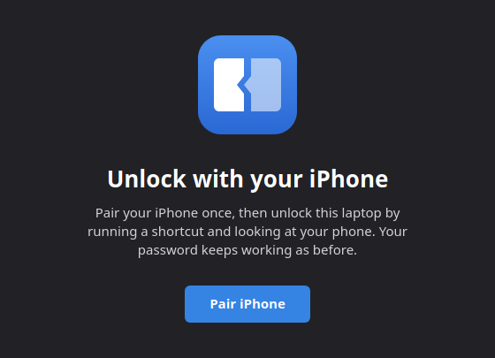
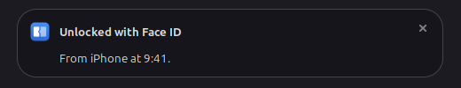
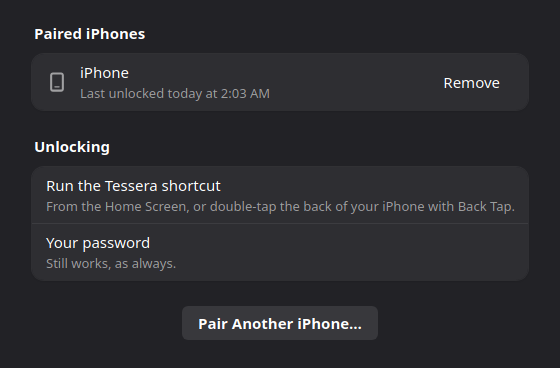
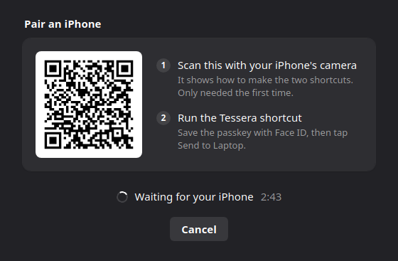
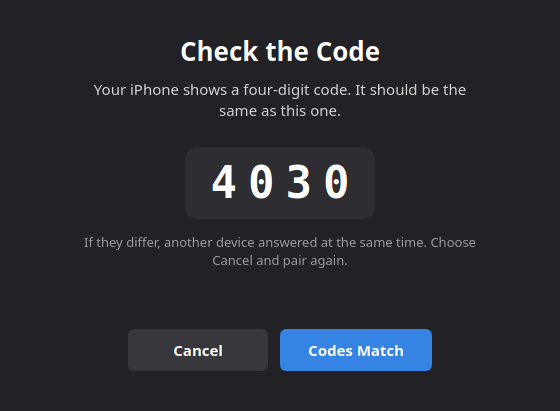

# Tessera

Unlock your Linux laptop with Face ID on your iPhone. Nothing to install on
the phone: it uses the Shortcuts app and Safari, which are already there.

Your password keeps working exactly as before. Tessera only adds a second
way in.

In ancient Rome a host and a guest broke a token in two, a *tessera
hospitalis*, and each kept a half. Years later, whoever brought the matching
half was welcomed as a friend. Tessera works the same way: your laptop keeps
one half (a public key), your iPhone keeps the other (a passkey that only
Face ID can use), and only a match opens the lock screen.



## Using it

Run the **Tessera** shortcut on your iPhone. Safari asks to use your passkey,
Face ID checks it's you, and you tap **Open** to hand the answer back to
Shortcuts. The laptop unlocks and tells you so:



Tessera's window shows which iPhones are paired and when each last unlocked
the laptop:



### Unlock with a double tap on the back of your iPhone

The quickest way to run the shortcut is **Back Tap**: tap the back of the
phone twice, look at it, done.

1. Open **Settings › Accessibility › Touch**.
2. Scroll to the bottom and tap **Back Tap**, then **Double Tap**.
3. Scroll down to **Shortcuts** and choose **Tessera**.

It also works from the **Action Button** (Settings › Action Button ›
Shortcut › Tessera) or as an icon on the Home Screen (in Shortcuts, touch
and hold Tessera › Share › Add to Home Screen).

## Setting it up

On the laptop:

```sh
git clone https://github.com/BeansAsset/tessera.git ~/tessera
~/tessera/install-integration.sh
```

The script checks what Tessera needs and, if anything is missing, shows the
exact command for your distro:

| Distro | Command |
| --- | --- |
| Linux Mint, Ubuntu, Debian, Pop!_OS | `sudo apt install python3-gi gir1.2-gtk-3.0 gir1.2-webkit2-4.1 python3-cryptography python3-qrcode` |
| Fedora | `sudo dnf install python3-gobject gtk3 webkit2gtk4.1 python3-cryptography python3-qrcode` |
| Arch, Manjaro | `sudo pacman -S --needed python-gobject gtk3 webkit2gtk-4.1 python-cryptography python-qrcode` |
| openSUSE | `sudo zypper install python3-gobject typelib-1_0-Gtk-3_0 typelib-1_0-WebKit2-4_1 python3-cryptography python3-qrcode` |

Then open **Tessera** from your apps menu and choose **Pair iPhone**:



1. Point your iPhone's camera at the QR code. It opens a page with the two
   shortcuts to make, **Tessera** and **Tessera Reply**, and Copy buttons for
   the addresses they need. This is only needed once.
2. Run the **Tessera** shortcut. Your iPhone offers to save a passkey;
   confirm with Face ID and tap **Send to Laptop**.
3. Check that the four-digit code on the iPhone matches the one on the
   laptop, and choose **Codes Match**.



The phone and the laptop need to be on the same Wi-Fi. The laptop is found by
its name (`yourlaptop.local`), which most distros support out of the box
through Avahi.

## How safe it is

The checks are all in [`tessera/webauthn.py`](tessera/webauthn.py) and
[`tessera/gate.py`](tessera/gate.py), with tests for each way an answer can
be wrong.

- **Face ID every time.** The passkey can only be used after Face ID (or
  the iPhone's passcode), and the laptop checks the phone's own report that
  it was. Someone holding your unlocked phone still can't use it.
- **Every unlock is a fresh question.** The laptop hands out a random
  one-time challenge; the phone signs it. An answer works once, within two
  minutes, and only on the laptop that asked.
- **Only your phone's key.** The laptop keeps the public half of the passkey
  from pairing, in `~/.config/tessera` (readable only by you), and checks
  every signature against it.
- **Pairing needs you at both ends.** It's only open for three minutes after
  you press Pair, and both screens show a code to compare, so a passkey sent
  by someone else at the same moment won't be accepted unnoticed.
- **Nothing to steal on the way.** The phone and laptop talk over your local
  network without encryption, but what passes is a challenge and a
  signature that's useless once used. No password or secret ever travels.
- **The web page holds no secrets.** Passkeys only work on a real website,
  so the part that runs on the phone is [a static page](docs/index.html)
  served by GitHub Pages. It can't sign anything without your face, and it
  sends the answer only back to your own shortcut.
- **It can only unlock the screen.** Tessera asks the system's session
  manager (logind) to unlock your own session, the same way a lock screen
  does. It runs as you, never as root, and can't do anything else.

What it doesn't do: unlock the first login after starting the laptop, or
unlock your saved passwords (the keyring). Those still use your password,
as on a Mac with an Apple Watch.

## Works with

Tested end to end on Linux Mint 22 (Cinnamon) with an iPhone: pairing, then unlocking the lock screen with Face ID. Lock screens that follow
logind's unlock signal should work the same way: GNOME, KDE and others.
Reports are welcome.

## Files

```
tessera/
  webauthn.py   checking passkeys and Face ID signatures
  gate.py       paired phones, one-time challenges, the decision to unlock
  server.py     the small local web service the shortcuts talk to
  session.py    unlocking this desktop session
  main.py       the app: the service and the window
  web/          the window (HTML, CSS, JS)
docs/           the page that runs on the iPhone (GitHub Pages)
tools/          setup for any common distro
tests/          python3 -m unittest discover -s tests
```

## License

GPL-3.0-or-later (`LICENSE`).
